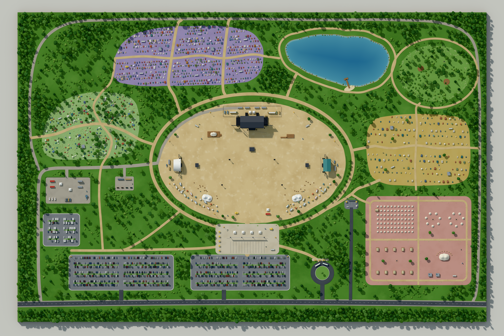
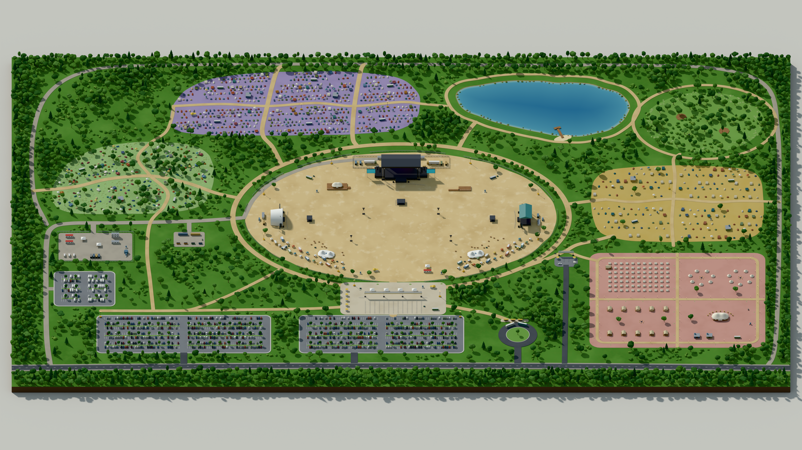
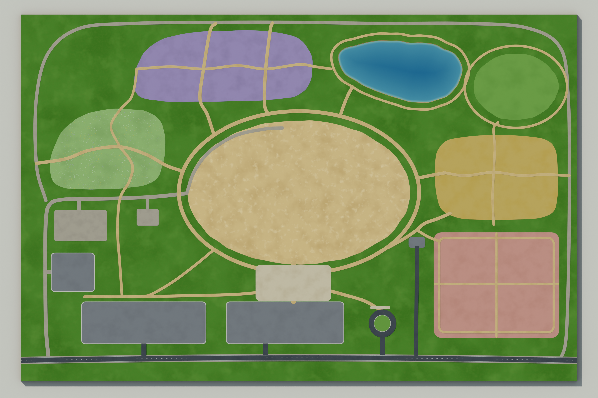

# Rocking the Daisies 2027: conceptual 3D festival site model

A complete festival site built procedurally in Blender with Python (`bpy`), styled as a polished miniature site model and viewed from directly above.

This is a conceptual design study. It is not an official or surveyed site plan for the festival. There is no text, signage, labelling, icons or graphic-design layout anywhere in the scene. Everything shown is modelled geometry: stages, tents, buildings, vehicles, trees, roads and parking bays.



| Elevated orthographic view | Layout preview (stages 1–4 only) |
| --- | --- |
|  |  |

## Files

| File | What it is |
| --- | --- |
| `festival_site.py` | The build script. It runs directly in Blender, or with the `bpy` module from PyPI. |
| `output/rocking_the_daisies_2027_site.blend` | The saved Blender project for the full scene. |
| `output/rtd2027_site_top.png` | Final top-down orthographic render, 4800 × 3200 px. |
| `output/rtd2027_site_oblique.png` | Slightly elevated orthographic view, 3840 × 2160 px. |
| `output/rtd2027_site_top_layout_preview.png` | Preview of terrain, water, roads, paths, arena and camping grounds, rendered before any props were added. |
| `output/rocking_the_daisies_2027_site_layout_preview.blend` | The layout-stage scene. |
| `output/details/*.png` | Full-resolution crops used for the final quality check. |

## How to run

### Blender command line (Blender 4.2 LTS or newer, including 5.x)

```bash
blender --background --python festival_site.py -- --out ./output
```

Options go after the `--`:

| Option | Default | Meaning |
| --- | --- | --- |
| `--stage layout\|full` | `full` | `layout` builds stages 1–4 only: terrain, dam, roads, paths, arena ground and camping grounds. Use it for a quick preview. |
| `--views top,oblique` | `top` | The cameras to render. |
| `--res 4800` | `4800` | Width of the top view in pixels. Its height is two-thirds of the width. The oblique view is capped at 3840 × 2160. |
| `--samples 128` | `128` | Cycles samples. Adaptive sampling and OpenImageDenoise are on. |
| `--no-render` | off | Build and save the `.blend` without rendering. |
| `--seed 2027` | `2027` | Seed for all scattering and placement. |

### Inside Blender

1. Open the **Scripting** workspace.
2. Open `festival_site.py` in the Text Editor.
3. Click **Run Script**.

The script clears the current scene first. To change options, edit the `CONFIG` dictionary at the top of the script. If you only want the scene, set `CONFIG["render"] = False`, because a 4800 px render blocks the UI for several minutes.

### Standalone Python, no Blender install

```bash
pip install bpy        # the wheel needs a matching Python version (3.13 for bpy 5.2)
python festival_site.py --out ./output --views top,oblique
```

The renders in `output/` were made this way, using `bpy` 5.2.2 LTS on a 4-core CPU with no GPU.

## Build stages

The script follows the requested build order. Each stage is a function, so stages can be run or inspected on their own.

| # | Stage | Functions |
| --- | --- | --- |
| 1 | Terrain and site boundary: a 1000 × 660 m grass grid on a 10 m model plinth, with a neutral display base | `build_terrain` |
| 2 | Dam, roads and walking paths: recessed water with a depth gradient, the shore slope, the access road and lane markings, gravel service routes, and the pedestrian network | `build_lake`, `build_roads_paths` |
| 3 | Main arena and stages: the arena ground, a main stage, two secondary stages, FOH positions, delay towers, backstage, food courts, bars, viewing decks and perimeter fencing | `build_grounds`, `build_main_stage`, `build_secondary_stage`, `build_arena_details` |
| 4 | Camping zones and tents: general, priority, wildflower, and the pre-pitched and glamping village | `build_grounds`, `build_camping`, `build_glamping` |
| 5 | Parking and entrances: two public car parks, staff parking, a shuttle turning loop, the main gate and the priority gate | `build_parking_ground`, `build_parking`, `build_entrances` |
| 6 | Trees and natural landscaping: woodland belts and clusters, isolated trees, shrubs, reeds, rocks, wildflower mounds, a jetty, a beach and the clearing | `plan_trees`, `build_vegetation`, `build_lake_features`, `build_clearing` |
| 7 | Facilities and smaller structures | `plan_facilities`, `build_facilities` |
| 8 | Materials, lighting and cameras | `build_materials`, `build_lighting_camera`, `setup_render` |
| 9 | Final render and quality checks | `render_view`, `stats`, plus the detail crops in `output/details/` |

A planning pass (`make_plan`) runs before any geometry is built. It rasterises every path, road, zone, the lake and every reserved footprint into 1 m occupancy masks. Every scatter step checks these masks. That is how tents stay off access routes, trees stay out of the arena and off paths, and facilities keep clear of circulation.

## Site layout

All dimensions are in metres, with +Y as north (the top of the render).

| Area | Location | Notes |
| --- | --- | --- |
| Main arena | Centre, a 400 × 260 m ellipse | The main stage sits on the north side. The west stage has an arched shell roof and the east stage a teal gable roof. Food courts form two arcs on the south side. There are two stretch-tent bars, VIP and accessible viewing decks, and info, first-aid, toilet and water points. A gated perimeter fence surrounds the arena, and a ring path runs around it. |
| General camping | North-west, lavender ground | Dense tent rows in blocks with fire lanes, split into six sections by paths. Toilets, showers, water points, bins and an info point are spread through it. |
| Wildflower camping | West, meadow ground | Small friend groups of tents around shared gazebos, among trees and daisy-speckled wildflower mounds. |
| Priority camping | East, ochre ground | Wider tent spacing, its own access route from the priority gate, and shade trees. |
| Pre-pitched and glamping village | South-east, dusty rose ground | Four quadrants: rows of pre-pitched tents, bell-tent rings around fire pits, safari tents on decks, and a lounge with showers and toilets. Lantern posts and planting line the shared paths. |
| Dam (lake) | North-east | Irregular shoreline with reeds, a jetty and a small beach, plus a loop path. |
| Grass clearing | Far north-east | Wellness decks and hay-bale circles. |
| Parking | South, along the access road | Car park A has 518 bays and car park B has 490. Both have planted islands and partly filled bays. Staff and operational parking (114 bays) is on the west side. |
| Shuttle drop-off | South, between car park B and the glamping village | A turning circle with a planted island, a passenger platform, shelters and buses. |
| Main entrance | Plaza between car park B and the arena | Box-office booths, queue lanes, a truss gate portal, search tents, an info and lost-property kiosk, and toilets. |
| Priority entrance | South-east of the arena | Its own asphalt lane from the road, a drop-off apron, a gate portal and booths. It serves priority camping and glamping. |
| Production, medical and staff compound | West, off the service road | Medical cabins with ambulances, a two-storey site office, containers, a generator, a water tank and staff catering, all fenced. |
| Waste and recycling depot | West of the arena | Skips and compactor containers on a gravel pad. |

### Emergency and service access

The gravel service road leaves the public road at the south-west corner. It passes the staff parking and the medical compound, then enters the arena at the west service gate behind the west stage. It continues inside the arena to the main-stage backstage. A perimeter track carries on from there around the whole site behind every camping field and returns to the road in the south-east. Emergency vehicles can therefore reach the arena and the edge of every camping field without crossing a tent pitch.

## Scene organisation

The scene is split into the following collections: **Terrain, Roads and Paths, Trees and Vegetation, Main Arena, Secondary Stages, Camping General, Camping Priority, Camping Wildflower, Glamping Village, Parking, Entrances, Facilities, Lake, Lighting and Camera**.

An extra **Asset Library (not rendered)** collection holds one reference object for each reusable asset. It is excluded from the view layer.

### Reusable assets and instancing

Each repeated asset is built once by its own function and placed as a **linked duplicate**: a new object that shares the asset's mesh, so Cycles instances it. The full scene has about 6,700 objects but only about 100 unique meshes. Per-object colour variation comes from `Object Info › Random` driving a constant colour ramp, so one mesh and one material give, for example, a whole field of differently coloured tents.

The asset functions are:
- Trees and plants: `asset_tree` (several variants), `asset_umbrella`, `asset_conifer`, `asset_shrub`, `asset_reeds`, `asset_rock`, `asset_flower_mound`.
- Tents: `asset_tent_dome`, `asset_tent_tunnel`, `asset_tent_ridge`, `asset_tent_family`, `asset_gazebo`, `asset_bell_tent`, `asset_safari_tent`, `asset_prepitched`.
- Food, bars and seating: `asset_stall`, `asset_food_truck`, `asset_stretch_bar`, `asset_stretch_lounge`, `asset_picnic`, `asset_hay_bale`.
- Facilities: `asset_toilet_block`, `asset_shower_block`, `asset_water_point`, `asset_info_kiosk`, `asset_bins`, `asset_skip`, `asset_container`, `asset_portacabin` (also used for medical cabins), `asset_generator`, `asset_fire_pit`, `asset_ticket_booth`, `asset_bus_shelter`.
- Lights: `asset_light_tower`, `asset_lantern`.
- Vehicles: `asset_car`, `asset_van`, `asset_ambulance`, `asset_bus`, `asset_truck`.

Small assets get real bevels: chamfered edges are baked into the mesh with `bmesh.ops.bevel`, which keeps them instanceable. Ground layers such as zones, paths and hard standings are raised slabs with a bevel modifier, so they catch light like the layers of a physical model.

## Rendering notes

- **Engine:** Cycles on CPU, with adaptive sampling and OpenImageDenoise. EEVEE needs a GPU or OpenGL context, so it is not used for the headless renders. Cycles' path-traced sky light gives the soft ambient occlusion and contact shading.
- **Light:** a soft sun from the north-west at about 38° elevation with a 3° angle, plus a pale sky fill.
- **Colour:** the *Khronos PBR Neutral* view transform at −0.7 EV. It keeps the restrained palette's hues truer than AgX does, and falls back to AgX or Filmic on older Blender versions.
- **Cameras:** `Camera_Top` is an orthographic camera looking straight down that frames the whole plinth. `Camera_Oblique` is an orthographic camera tilted 50°, used for the elevated model view.
