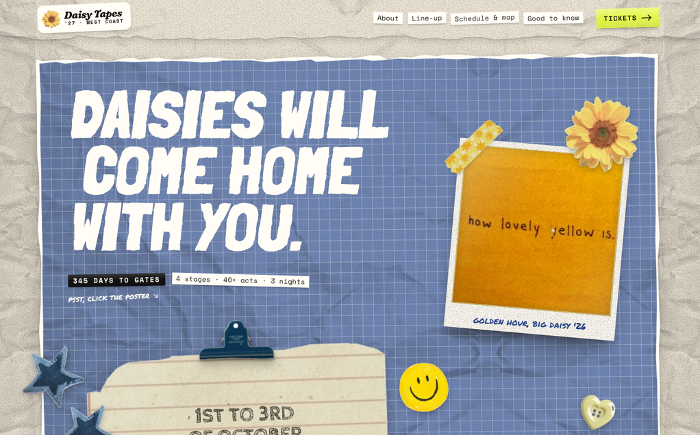

# Daisy Tapes '27: Analog Scrapbook festival template

A complete, responsive festival site in the analog scrapbook / tactile collage style, built with Client-First classes so it can be rebuilt in Webflow or Relume.



## What's in the page

- **Hero:** torn denim grid poster, brush-poster headline, notebook note with binder clip, polaroid, denim star patches, perforated stamp, ticket-stub CTA, countdown. Click the poster to stick stickers on it.
- **Hoard the feelings:** mustard grid collage with a dictionary clipping, the quote card and the yellow sticker set.
- **Line-up:** taped flyers on a binder page, filterable by day and stage, with tilt, tape-peel and xerox hover and saveable favourites.
- **Schedule + map:** ARIA tabs styled as index tabs on a stapled zine. Rows sit on the notebook ruling, and stars sync with the line-up. The map uses stickers as landmarks.
- **Tickets:** three wristband tickets with woven bands, notched perforations and tear-off stubs.
- **Good to know:** sticky-note FAQ. **Sign-up:** postcard form with a postmark animation. **Footer:** black construction paper.

## Run it

Open `index.html` through any static server (the fonts load from Google Fonts):

```bash
npx http-server templates/scrapbook-festival -p 8080
```

## Build it in Webflow

Start with [`WEBFLOW.md`](./WEBFLOW.md). It covers the class architecture, tokens, the exact CSS for `tape-badge` / `paper-card` / `scrapbook-hero`, navigator trees, CMS mapping, interaction recipes (IX2 + GSAP) and the responsive rules. Paste-ready Embed snippets are in [`embeds/`](./embeds).

The matching agent skill lives in [`skills/scrapbook`](../../skills/scrapbook).

_Daisy Tapes, Madeliefie Farm and every act are fictional placeholders. Swap in your festival's name and content._
